<div align="center">
  <h1>Coding RPG</h1>

  <h3>コードを書くほど，リポジトリのキャラが成長する．</h3>

  <p>
    
    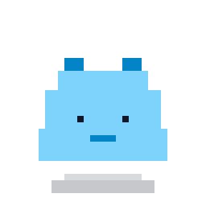
    
    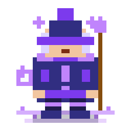
    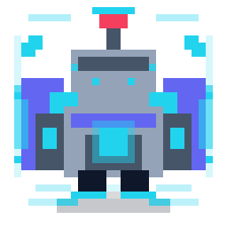
  </p>

  <p>
    <a href="https://supporters-hackathon.vercel.app/"><strong>▶ Coding RPG で遊ぶ</strong></a>
  </p>
</div>

---

**Coding RPG** は，GitHub のリポジトリでキャラクターを育てる Web アプリです．

リポジトリごとに相棒のキャラクターを1体選び，コミットを push するたびに経験値が貯まります．
レベルが上がるとキャラクターが進化して，見た目もどんどん豪華になっていきます．

毎日のコミットが，キャラクターの成長として目に見える．
「今日もちょっとだけコードを書こう」と思えるアプリを目指しました．

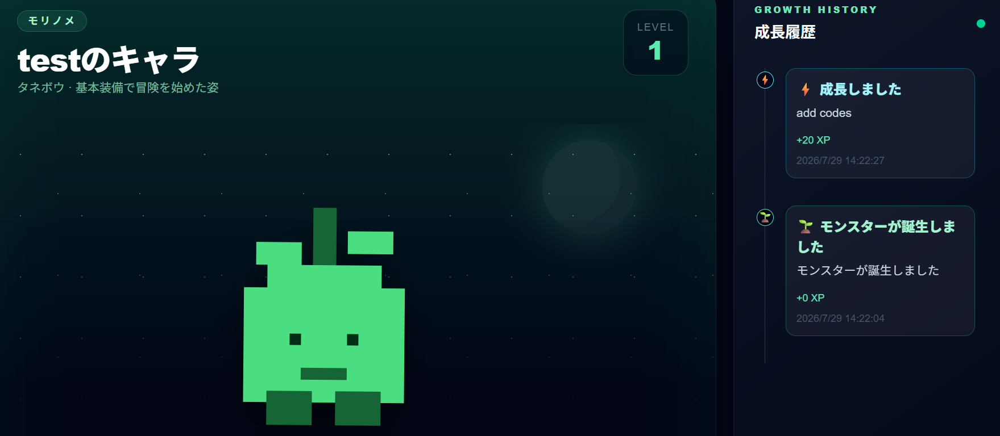

## 育てると，こう進化する

レベルが上がるごとに姿が変わり，レベル5で最終形態になります．

<table>
  <tr>
    <th>Lv.1</th>
    <th>Lv.2</th>
    <th>Lv.3</th>
    <th>Lv.4</th>
    <th>Lv.5</th>
  </tr>
  <tr>
    <td align="center"></td>
    <td align="center"></td>
    <td align="center"></td>
    <td align="center"></td>
    <td align="center">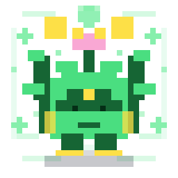</td>
  </tr>
  <tr>
    <td align="center">モリダネ</td>
    <td align="center">モリノメ</td>
    <td align="center">ワカバネ</td>
    <td align="center">ハナモリ</td>
    <td align="center">セカイジュ</td>
  </tr>
  <tr>
    <td align="center"></td>
    <td align="center"></td>
    <td align="center"></td>
    <td align="center"></td>
    <td align="center"></td>
  </tr>
  <tr>
    <td align="center">旅立ちの勇者</td>
    <td align="center">青き勇者</td>
    <td align="center">聖剣の勇者</td>
    <td align="center">王国の勇者</td>
    <td align="center">暁の英雄</td>
  </tr>
</table>

## 28体の仲間たち

モンスターや機械，冒険の仲間，そして敵キャラクターまで，28体から相棒を選べます．
一度選んだキャラクターは変更できないので，じっくり選んでください．

<table>
  <tr>
    <td align="center"><br />スライム</td>
    <td align="center"><br />ゴーレム</td>
    <td align="center"><br />騎士</td>
    <td align="center">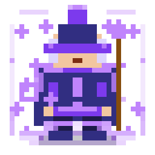<br />魔法使い</td>
    <td align="center">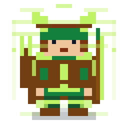<br />弓使い</td>
    <td align="center"><br />商人</td>
  </tr>
  <tr>
    <td align="center">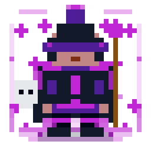<br />闇の魔法使い</td>
    <td align="center">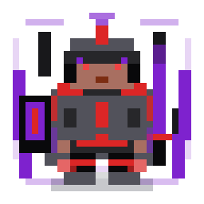<br />堕落した騎士</td>
    <td align="center">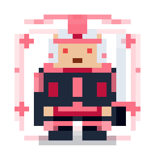<br />敵対する勇者</td>
    <td align="center">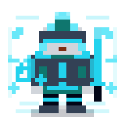<br />人造人間</td>
    <td align="center">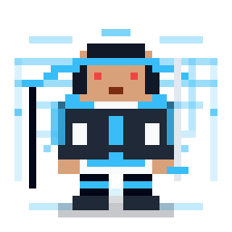<br />剣豪</td>
    <td align="center">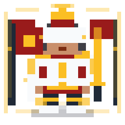<br />宮廷将軍</td>
  </tr>
</table>

<sub>※ 画像はレベル5（最終形態）の姿です．ほかにも，僧侶・盗賊・武闘家・吟遊詩人・暗殺者・狂戦士などがいます．</sub>

## 遊び方

1. **GitHub でログイン**
   サイトを開いて，GitHub アカウントでログインします．
2. **リポジトリを連携する**
   「リポジトリの追加・連携解除」から GitHub の画面へ進み，育てたいリポジトリを選びます．選んだリポジトリのコードは読み取るだけで，書き換えることはありません．
3. **相棒を選ぶ**
   アプリに戻ると，キャラクターの選択画面が出ます．リポジトリごとに1体を選びましょう．
4. **コミットして育てる**
   あとはいつもどおり開発して push するだけ．コミットの内容に応じて経験値が入り，画面のキャラクターがその場で成長します．

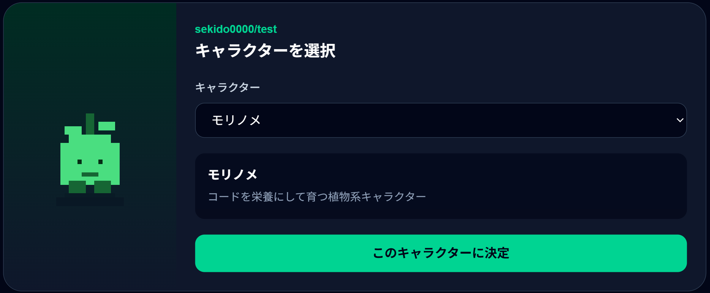

## たくさん育てるコツ

経験値はコミット1件ごとに計算されます．

| こんなコミットは | 経験値 |
| --- | --- |
| 新しい機能を作った | ⚡ 20 XP |
| 性能を改善した | 🚀 15 XP |
| バグを直した | 🔧 12 XP |
| リファクタリング・テストを書いた | ♻️ ✅ 10 XP |
| ドキュメントを書いた | 📘 8 XP |
| ビルドや設定を変えた | 🛠️ 5 XP |
| 書式・雑務・取り消し・その他 | 🌱 3 XP |

さらに，ボーナスもあります．

- **変更量ボーナス**：変更した行数に応じて最大 +8 XP
- **本文ボーナス**：コミットメッセージの本文に「なぜ変更したか」を書くと +5 XP

反対に，「update」「修正」だけのように**何をしたか分からないメッセージ**だと，経験値は半分になります．
空白だけの変更や空コミットでは育ちません．ずるはできないので，こつこつ育てましょう．

コミットの種類は，`feat:` のような書き方でも，「ログイン画面を追加」のような普通の日本語や英語でも判定されます．

<details>
<summary><strong>開発者向けの情報</strong></summary>

### 技術構成

| 分類 | 使用技術 |
| --- | --- |
| フロントエンド | Next.js 16（App Router），React 19，TypeScript，Tailwind CSS 4 |
| バックエンド | Next.js（Route Handlers，Server Actions） |
| データベース・認証 | Supabase（PostgreSQL，Auth，Realtime） |
| GitHub 連携 | GitHub App（Webhook，REST API / Octokit） |
| テスト・CI | Vitest，ESLint，GitHub Actions |
| ホスティング | Vercel |

キャラクターのドット絵（SVG）は，[scripts/](scripts/) のスクリプトでコードから生成しています．

### 仕組み

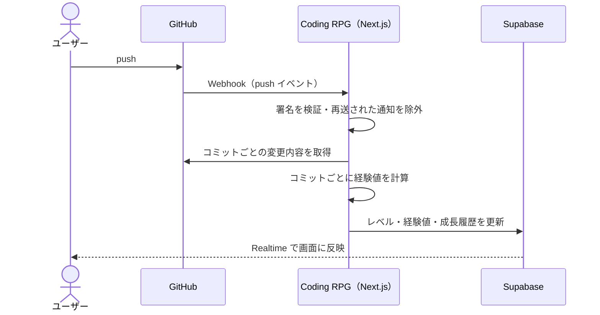

- 経験値の計算は [src/lib/growth/xp.ts](src/lib/growth/xp.ts)，レベルアップの計算は [src/lib/growth/level.ts](src/lib/growth/level.ts) にあり，単体テストがあります．
- Webhook は署名を検証し，GitHub から再送された通知を `X-GitHub-Delivery` で除外して，経験値の二重加算を防いでいます．
- push が同時に届いても加算が消えないよう，楽観的ロックで更新しています．
- Supabase の Row Level Security で，ブラウザからは本人のデータだけを読めるようにしています．書き込みはサーバーからのみ行います．

### ディレクトリ構成

```text
coding-rpg/
├── src/
│   ├── app/               # 画面・API（App Router）
│   │   ├── api/github/    # GitHub Webhook の受信
│   │   ├── auth/          # ログイン後のコールバック
│   │   └── github/        # GitHub App のインストール・セットアップ
│   ├── components/        # UI コンポーネント
│   ├── data/              # 画面用のデータ取得
│   └── lib/
│       ├── github/        # GitHub API・Webhook の処理
│       ├── growth/        # 経験値・レベルの計算
│       ├── characters/    # キャラクターの定義（自動生成）
│       └── supabase/      # Supabase クライアント
├── scripts/               # キャラクター SVG の生成スクリプト
├── supabase/migrations/   # データベースのスキーマ
└── public/characters/     # キャラクター画像（自動生成）
```

### ローカルでの起動

必要なもの：Node.js 20.9 以上（CI では 24 を使用），Supabase のプロジェクト，自分で作成した GitHub App

**1. Supabase の準備**

1. [supabase/migrations/](supabase/migrations/) の SQL を，ファイル名の順に SQL Editor で実行します．
2. Authentication → Providers で GitHub を有効にし，GitHub OAuth App の Client ID と Client Secret を設定します．
3. Authentication → URL Configuration の Redirect URLs に `http://localhost:3000/auth/callback` を追加します．

**2. GitHub App の作成**

GitHub の Settings → Developer settings → GitHub Apps から作成します．名前は任意です．

| 項目 | 設定値 |
| --- | --- |
| Setup URL | `<サイトの URL>/github/setup`（「Redirect on update」にチェック） |
| Webhook URL | `<サイトの URL>/api/github/webhook` |
| Webhook secret | 任意のランダムな文字列（`GITHUB_WEBHOOK_SECRET` と同じ値） |
| Repository permissions | Contents: Read-only |
| Subscribe to events | Push |

作成後，App ID を控え，秘密鍵（`.pem`）を生成します．
ローカルでは GitHub からの Webhook が届かないため，push で経験値が入るところまで試すには，[smee.io](https://smee.io/) などで Webhook を転送する必要があります．

**3. 環境変数**

`.env.example` をコピーして `.env.local` を作り，値を設定します．

| 変数 | 内容 |
| --- | --- |
| `NEXT_PUBLIC_SUPABASE_URL` | Supabase の Project URL |
| `NEXT_PUBLIC_SUPABASE_PUBLISHABLE_KEY` | Supabase の publishable key |
| `SUPABASE_SECRET_KEY` | Supabase の secret key（サーバーでのみ使用） |
| `GITHUB_APP_ID` | GitHub App の App ID |
| `GITHUB_APP_PRIVATE_KEY_BASE64` | GitHub App の秘密鍵を Base64 エンコードした値（`base64 -w 0 key.pem`） |
| `GITHUB_WEBHOOK_SECRET` | GitHub App の Webhook secret |
| `GITHUB_INSTALL_STATE_SECRET` | インストール時の `state` の署名に使う任意のランダムな文字列 |

**4. 起動**

```bash
npm install
npm run dev
```

| コマンド | 内容 |
| --- | --- |
| `npm run dev` | 開発サーバーを起動 |
| `npm run build` | 本番用にビルド |
| `npm run lint` | ESLint を実行 |
| `npm run typecheck` | 型チェック |
| `npm test` | 単体テスト（Vitest） |
| `npm run generate:characters` | キャラクターの SVG と定義ファイルを生成 |

</details>
